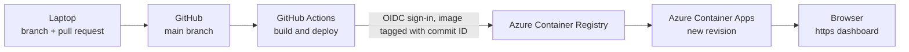

# CPSY 300 Team Project: Recipe Insights Dashboard

A Next.js dashboard that turns a real nutrition data set (`data/All_Diets.csv`, 7,806 recipes across five diets) into charts and insights. It is packaged as a container, runs on Azure Container Apps, and is redeployed by a GitHub Actions pipeline on every merge to `main`.

## Architecture



1. A change is made on a branch and opened as a pull request. A teammate reviews and approves it.
2. Merging to `main` starts the **Build and deploy** workflow (`.github/workflows/deploy.yml`).
3. The workflow signs in to Azure with OIDC (no stored password), builds the image, tags it with the commit ID and pushes it to the registry.
4. The workflow updates the container app to that image, which creates a new revision.
5. Visitors reach the dashboard over https at the container app's address.

## What the app does

- `lib/data.ts` reads `data/All_Diets.csv`.
- `lib/insights.ts` applies five cleaning rules (tidy names, remove unusable rows, remove duplicates, remove extreme values above 1,000 g, keep and count zeros) and computes five insights: averages per diet, top-protein recipes, common cuisines, protein/carb/fat ratios, and data quality.
- `app/page.tsx` is the dashboard page (server-rendered). The heading comes from the `DASHBOARD_TITLE` environment variable.
- `app/components/Charts.tsx` draws the three charts in the browser.
- `app/api/insights/route.ts` returns the same insights as JSON at `/api/insights`.

Expected data-quality numbers: 7,806 rows read, 720 duplicates removed, 63 extreme values removed, 39 recipes kept with 0 g protein or fat, 7,023 rows used.

## Run locally

```bash
npm install
npm run dev
```

Open http://localhost:3000 and http://localhost:3000/api/insights.

## Run in a container

```bash
docker build --platform linux/amd64 -t recipes:local .
docker run -d --name recipes -p 8080:3000 -e DASHBOARD_TITLE="Local test" recipes:local
```

Open http://localhost:8080. Stop it with `docker stop recipes` and `docker rm recipes`.

## Configuration

| Variable | Purpose | Default |
|---|---|---|
| `DASHBOARD_TITLE` | Heading shown on the dashboard. Set on the container app in Azure, so changing it creates a new revision without a rebuild. | `Recipe insights` |

## Team workflow

`main` is protected: every change arrives through a pull request approved by a teammate. Never commit passwords or keys; the pipeline's Azure credentials are GitHub repository secrets.
